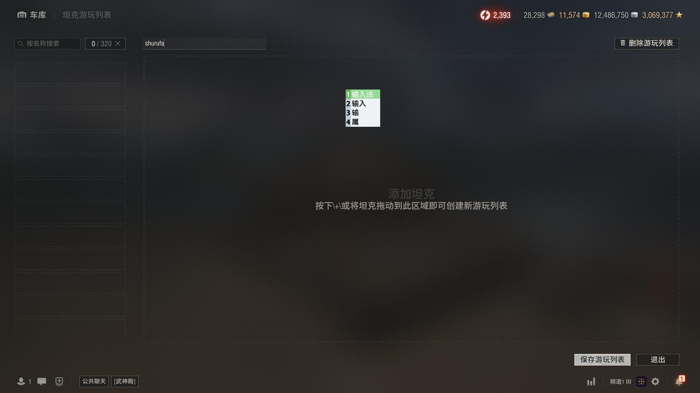
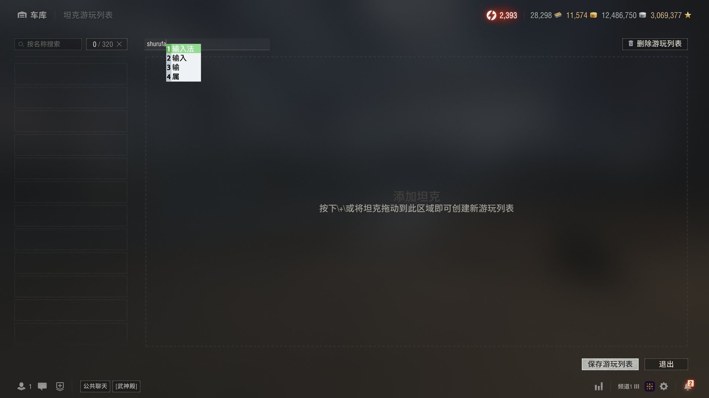
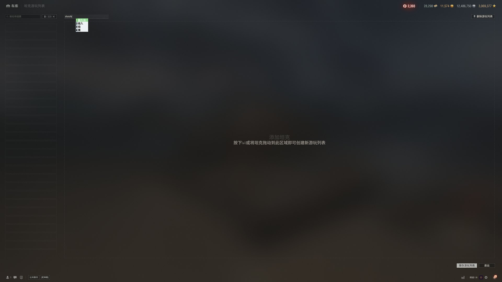

# World of Tanks CN(360) 输入法候选框错位修复

非 1X 界面缩放下，国服《坦克世界》自绘的中文输入法候选框会偏移到光标右下方，
输入框靠近屏幕边缘时整块跑出屏幕外。本项目通过替换 `gui\flash\ime.swf` 修复该问题，
包含补丁源码（AS3）、构建脚本，以及偶游盒子 `.wbp` 安装包的打包脚本。

> Fixes the misplaced IME candidate window in **World of Tanks CN (360)**
> when the interface scale is not 1x. AS3 patch sources, build scripts and a
> `.wbp` packer for the Oujou mod box.

## 下载

已经打好的安装包放在 [Releases](https://github.com/wumingzhiren/World-of-Tanks-CN-360-IME-Candidate-Fix/releases)：

| 文件 | 说明 |
|---|---|
| `WoT-CN360-IME-Candidate-Fix-2.4.2.0.wbp` | 适配游戏 2.4.2.0，偶游盒子直接安装，也可解压后手动放 |

1X 缩放本来就正常，不用装。游戏换成别的版本号时，按下面「打包成 .wbp」自己打一个。

## 效果

3840×2160 + 2X 界面缩放，同一个「坦克游玩列表 → 添加坦克」搜索框：

| 修复前：候选框偏到右下，与光标分离 | 修复后：候选框贴合输入框 |
|---|---|
|  |  |

1X 缩放下候选框本来就是对的，只是界面元素小到看不清，这也是很多人宁可开 2X 的原因：



候选框本身的原始渲染尺寸（1:1 裁切，188×205）：


## 文件来源

`ime.swf` 是**游戏自带文件**，本补丁不新增任何文件，只是用同路径的修改版覆盖它。

| 项 | 值 |
|---|---|
| 路径 | `<游戏目录>\res\gui\flash\ime.swf` |
| 大小 | 5,763 字节（2.4.2.0 客户端，文件日期 2025-09-10） |
| MD5 | `8109d4f89fcc511ec1a1687f91082011` |

**它不在任何 `.pkg` 里。** 该目录下 9 个 `.swf`（`ime.swf` 与 8 个 `fonts_*.swf`）全部是散装文件，客户端更新时直接落盘，所以在 `res\packages\` 里翻是找不到的。

`res\packages\gui-part3.pkg` 里只有一个配套的 `gui/flash/ime.xml`（15,464 字节），内容是「Windows 输入法名称 → GFxIME 标签」的映射表（如 `Chinese (Simplified) - Microsoft Pinyin IME` → `GFxIME_Ch_Simp_MSPinyin`），负责让引擎认出当前用的是哪个输入法，不是候选框本体。

自证方法（Windows）：

```bat
certutil -hashfile "<游戏目录>\res\gui\flash\ime.swf" MD5
```

输出应为 `8109d4f89fcc511ec1a1687f91082011`。包内 `Files\ime.swf` 的 MD5 是 `22743338d2bca5f8400fdc816c5f6eaf`，两者不同，差异只在那 3 个类。

## 症状

- 只在**非 1X**界面缩放下出现（2X / 1.5X / 1.25X / 0.75X），1X 正常；
- 候选框整体平移到光标右下方，偏移量约等于「坐标 × 倍率」，缩放越大偏得越多；
- 输入框靠近屏幕右侧或下侧时，候选框直接被推到屏幕外看不见；
- 拼音串窗口（候选框上方那串字母）同样偏移。

## 根因

`ime.swf` 里改了三处。第 2 条是位置偏移的直接原因；第 1 条是同一条渲染链路上的
另一处缺陷，位置修好、列表真的画出来之后才暴露（源文件本来就坏，只是以前根本
画不出来，所以此前没人见过）。

**1. 跨类读 private 字段拿到 `undefined`**

`FxCandidateListBox` 的 16 个字段声明为 `private`，而 `MainTimeline` 与 `ListRow`
都用 `candidateList.xxx` 跨类读取。AS3 跨类访问 private 不报错，只返回 `undefined`：

| 读的字段 | 实际值 | 后果 |
|---|---|---|
| `DisplayItemIndex` | `undefined` | `while (i < undefined)` 一次不进，10 行全堆在 (0,0) |
| `uint(BackgroundColor)` | `uint(undefined)` = `0` | ColorTransform 加色为 (0,0,0)，纯黑底 |
| `FontSize` | `NaN` | `TextFormat.size = NaN`，字号异常 |

**2. 候选框位置没有做缩放换算**

原始 `RepositionCandWindow` 直接 `this.candListx = param1;`。
2X 下 SWF 内容坐标空间是 1920 宽、渲染时整体放大 2 倍到 3840 物理像素，
而引擎传进来的是物理坐标，于是整块列表被画到 2 倍位置。

**3. 拼音串窗口同样问题**

`RepositionInputWindow` / `DisplayInputWindow` 也是原样赋值，一并按倍率换算。

## 改了什么

`src\` 下只有三个被改的类：

- `FxCandidateListBox.as` —— 16 个 `private var` 改 `public var`，新增 `public var PxScale`
- `IME_fla\MainTimeline.as` —— 坐标按 `k` 换算、修正窗口尺寸换算、`DisplayCallback` 加判空与 `try/catch`
- `ListRow.as` —— 字号保持样式原值

倍率 `k` 的取法，三级兜底：

```as
k = stage.transform.matrix.a      // 首选：舞台变换矩阵，等于界面缩放本身
if (!(k > 0.05 && k < 8)) k = 0;  // 取不到才往下退
k = caret / 13.9                  // 退回：复合字串高度
k = stageWidth / 1920             // 再退回
k = Math.round(k * 20) / 20       // 归到 0.05 网格
k = clamp(k, 0.5, 4)              // 异常兜底
```

**为什么不能只用光标高度**：同一个 2X 界面里，不同输入框传给 IME 的字高并不统一。

实测日志（2X，同一局）：

| 场景 | `param3` 字高 | 按字高算的 k | 舞台矩阵 | 应为 |
|---|---|---|---|---|
| 车库聊天框 | 27.80 | 2.00 | 2/2 | 2 |
| 添加坦克搜索框 | **13.45** | **0.95** | 2/2 | 2 |

新版大厅那个搜索框的字号不随界面缩放变化，字高停在 1X 量级，按字高算得到 `k≈1`，
坐标等于没除，候选框被画到两倍位置（截图里 `1884 = 942×2`）。矩阵在两种场景下都稳定给出 2。

1X / 2X 对照（同一份客户端，未重启）：

| 缩放 | 舞台矩阵 | 聊天框字高 | 搜索框字高 |
|---|---|---|---|
| 2X | 2/2 | 27.80 | 13.45 |
| 1X | 1/1 | 13.90 | 13.90 |

`k` 每次定位实时重算（`NoteCaret()` → `GetPixelScale()`），游戏里改界面缩放
**不用重进客户端**，下一组拼音就跟着换。实测 2X / 1X 来回切换，两处输入框均贴合光标。

**字号不乘 `k`**，直接用样式原值：

```as
sz = fontSize;                             // 原值，不缩放
if (!(sz > 0) || sz > 240) sz = fontSize;  // 异常值兜底
size = sz;
```

SWF 根节点已被引擎按界面倍率整体放大，字号再乘一次 `k` 就是放大两次（2X 下变 4 倍）。
这一点是量图量出来的：

| 参照 | 框宽 | 每行高 |
|---|---|---|
| 候选框 1:1 裁切（`docs/images/candidate-window-1to1.png`） | 188 px | 50 px |
| 3840×2160 原图里的同一个框 | 189 px | 50 px |
| 若按 `fontSize * k` 渲染（2X） | ≈376 px | ≈100 px |

也就是说**原始字号本来就是对的，只有坐标错了**。候选框宽度内边距同样用原值 `+ 10`。

## 目录

```
.
├─ src\                       补丁源码（只含被改的 3 个类）
│  ├─ FxCandidateListBox.as
│  ├─ ListRow.as
│  └─ IME_fla\MainTimeline.as
├─ scripts\                   构建与打包脚本
│  ├─ build.bat               源码 + 原版 swf → build\ime.swf
│  ├─ build_wbp.py            .wbp 打包核心（可传参：版本号 / 作者）
│  ├─ build_package.py        交互式打包：先问版本号，再出包
│  ├─ 打包.bat                双击入口，等价于 python build_package.py
│  └─ make_cover.ps1          用候选框截图生成列表页封面
├─ docs\
│  └─ images\                 对比图、封面、1:1 裁切
├─ build\                     构建与打包输出（不入库）
├─ README.md
└─ LICENSE
```

`build\` 里的二进制（原版 swf、编译产物、`.wbp`）都不入库：
`ime.swf` 是游戏自带资源，版权归 Wargaming，请自行从客户端取。

## 构建

需要 [JPEXS Free Flash Decompiler](https://github.com/jindrapetrik/jpexs-decompiler)
的 CLI 版 `ffdec-cli.exe`（放进 `PATH`，或先 `set FFDEC=D:\path\to\ffdec-cli.exe`）。

1. 准备原版基线（从自己装的客户端里取，不要用别人传的）：

   ```
   copy "<游戏目录>\res\gui\flash\ime.swf" build\ime_orig.swf
   ```

   该文件是散装的（不在 `.pkg` 内），直接复制即可，不需要解包。较老的客户端如果
   确实没有这个路径，再去 `res\packages\gui*.pkg` 里找 `gui/flash/ime.swf`
   （2.4.2.0 这一版已确认 pkg 内没有该文件）。

2. 编译：

   ```
   scripts\build.bat
   ```

   等价于 `ffdec-cli -importScript build\ime_orig.swf build\ime.swf src`。

3. 散装安装：把 `build\ime.swf` 复制到
   `<游戏目录>\res_mods\<版本号>\gui\flash\ime.swf`。

## 打包成 .wbp

游戏更新后目录名变成 `res_mods\<新版本>\`，重打一次包就行，`ime.swf` 不用重编：

```
双击 scripts\打包.bat            # 先问版本号，默认取本机 mods\ / res_mods\ 下最新版本
python scripts\build_package.py 2.4.3.0              # 命令行指定版本
python scripts\build_package.py 2.4.3.0 你的昵称      # 版本 + 作者
```

脚本会扫本机游戏目录（可用环境变量 `WOT_DIR` 覆盖）列出已装版本作默认值，
校验版本号格式，最后打印包大小、包 MD5 与内含 `ime.swf` 的 MD5，输出在 `build\`。

### .wbp 格式

`.wbp` 本质是 zip，三个条目（结构照抄站内任意一个官方样例即可）：

| 条目 | 内容 |
|---|---|
| `Files/ime.swf` | 实际替换文件（loose 模式，直铺 `res_mods`） |
| `wbpimg.jpg` | 列表页封面，242×235 |
| `wbpinfo` | GB2312 的 XML 清单，`EscapePath` 决定装到哪 |

```xml
<ID>33C8ADA77A3A43BE866119AA85627691</ID>   <!-- 32 位大写 hex，固定不变，改了就成另一个插件 -->
<Name>非1X缩放下输入法候选框错位修复</Name>
<Version>2.4.2.0</Version>
<Author>...</Author>
<Url><![CDATA[https://github.com/...]]></Url>
<Summary><![CDATA[一句话简介]]></Summary>
<EscapePath>
  <File Name="res_mods\2.4.2.0\gui\flash\ime.swf"/>
</EscapePath>
```

打包脚本给所有条目写固定时间戳，**同样的输入永远得到同一个 MD5**，便于核对。

### 为什么不用 wotmod

一开始打成 `mods\<版本>\xxx.wotmod`，日志里明明写着 `Mod package ... loaded`，
但候选框一点变化都没有。

原因不在 wotmod 的打包格式，而在加载层级：`ime.swf` 是 `res\` 下的**物理文件**，
而 `mods\` 是 wotmod 的虚拟挂载层，排在 `res\` 物理文件之后，盖不住磁盘上真实存在的那个文件
（实测：`mods` 里只对**新增**资源生效，覆盖 `ime.swf` 无效，三次 `loaded` 都无效果）。

资源优先级从高到低大致是 `res_mods\<版本>` > `res`（散装）> `res\packages\*.pkg`。
`res_mods` 是硬覆盖，这条路和盒子自己替换 `battle.swf` / `lobby.swf` 一致。

> 顺带一个坑：wotmod 内条目必须 stored（不压缩），deflate 会被引擎以
> `load error: compression not supported` 拒绝。

## 安装 / 回滚

安装就是把 `ime.swf` 放到 `res_mods\<版本号>\gui\flash\`，或者用盒子装 `.wbp`。

回滚：删掉 `res_mods` 里的 `ime.swf`，游戏自动回落到 `res\gui\flash\ime.swf`（原版）。

## 已知限制

- 只有在读不到舞台矩阵时才退回字高 / 分辨率估算，此时 1X 与「字号不随缩放」的
  搜索框无法区分（都会算成 1）。实测场景里矩阵始终可读，这条兜底没触发过。
- 只在 3840×2160 + 2X + 搜狗拼音上完整验证过；其它分辨率 / 输入法如果有偏差，
  请附 `game.log` 提 issue。
- SWF 里保留了 `DisplayCallback` 异常时的单行日志 `IMEFIX DisplayCallback ERROR id=...`，
  正常使用时不会出现在 `game.log`。

## 许可

代码与文档用 MIT。

`ime.swf` 及其它游戏资源版权归 Wargaming.net。本仓库不含任何游戏原始资源
（`build\` 与 `*.wbp` 均在 `.gitignore` 内）；Releases 附件里的 `.wbp` 只含修改后的
`ime.swf`，用途是替换客户端内的同名文件，不含额外资源。详见 [LICENSE](LICENSE)。
